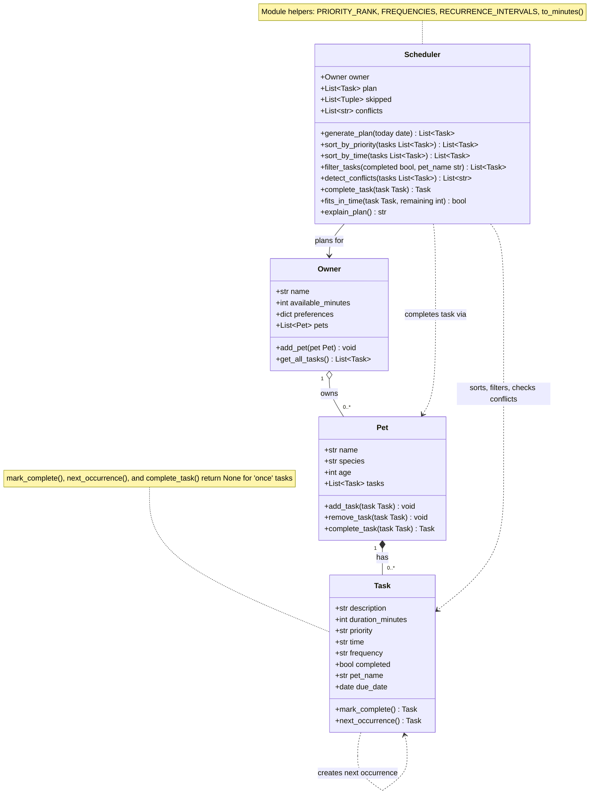

# 🐾 PawPal+

PawPal+ is a pet care planner for busy owners. Enter your pets and their care tasks (walks, feeding, meds, grooming), say how much time you have today, and PawPal+ builds a daily plan: it picks the most important tasks that fit, puts them in time order, warns about scheduling clashes, and explains every decision.

Built with Python and [Streamlit](https://streamlit.io) for CodePath AI110, Module 2.

## Contents

- [Features](#-features)
- [Getting Started](#-getting-started)
- [Demo Walkthrough](#-demo-walkthrough)
- [How Scheduling Works](#-how-scheduling-works)
- [Architecture](#-architecture)
- [Testing PawPal+](#-testing-pawpal)
- [Project Structure](#-project-structure)

## ✨ Features

- **Greedy priority scheduling:** `generate_plan()` gathers every pet's tasks, drops ones that are completed or not yet due, and sorts the rest by the key `(-priority rank, duration)`: high before medium before low, shorter first on ties. It then walks that list once and adds each task that fits in the minutes left. A task that doesn't fit is skipped and the walk continues, so a shorter task later in the list can still fill the gap. This is a greedy approach: it always honors priority first and doesn't search for the combination that uses the most minutes.
- **Numeric priority ranking:** priorities map to numbers (`high` = 3, `medium` = 2, `low` = 1) through `PRIORITY_RANK`, so they sort by importance instead of alphabetically.
- **Chronological sorting:** `sort_by_time()` sorts by the key `(due date, has no time, "HH:MM")`. Earlier days come first, timed tasks come in clock order within each day, and tasks with no set time go last. It returns a new list and leaves the input unchanged.
- **Combinable filtering:** `filter_tasks(completed, pet_name)` keeps the tasks that match every filter given. A filter left as `None` is ignored, so you can filter by pet, by status, by both, or not at all.
- **Interval-based conflict detection:** `detect_conflicts()` treats each timed task as a half-open interval `[start, start + duration)` in minutes since midnight. It sorts tasks by date and start time, then compares each task only with the tasks that start before it ends, stopping early once there's no overlap. Exact same-time tasks and partial overlaps are flagged, for the same pet or different pets, while back-to-back tasks are not. Conflicts are returned as warnings, not errors, and a malformed time gets its own warning instead of crashing the check.
- **Date-based recurrence:** completing a `daily` or `weekly` task creates a copy with `completed=False` and `due_date` moved forward by 1 or 7 days (`timedelta`). It's made with `dataclasses.replace()`, so the description, time, priority, and pet carry over. `once` tasks return `None`. Completing an already-completed task does nothing, so a double-click can't create duplicate copies.
- **Due-date gating:** each task has a `due_date`, and the planner only considers tasks due today or earlier, so tomorrow's copy of a recurring task stays out of today's plan. Overdue tasks are still included.
- **Input validation:** a `Task` checks its values when it's created and rejects a non-positive duration or an unknown priority or frequency with a `ValueError`.
- **Explainable output:** every task left out of the plan is recorded with a reason, such as "already completed", "not due until 2026-10-19", or "needs 20 min but only 5 min left". `explain_plan()` combines the plan, the warnings, and the skipped tasks into a plain-language summary.

## 🚀 Getting Started

### Requirements

- Python 3.10 or newer (developed and tested with Python 3.13)
- The packages in `requirements.txt` (Streamlit and pytest)

### Setup

```bash
python -m venv .venv
source .venv/bin/activate  # Windows: .venv\Scripts\activate
pip install -r requirements.txt
```

### Run

| Command | What it does |
|---------|--------------|
| `streamlit run app.py` | Opens the PawPal+ app in your browser |
| `python main.py` | Runs a two-pet demo of every feature in the terminal |
| `python -m pytest` | Runs the test suite |

## 📸 Demo Walkthrough

### Main features and actions

Run `streamlit run app.py` to open the app. It's one page with six areas, from top to bottom:

| Area | What you can do |
|------|-----------------|
| **Owner** | Set your name and the minutes you have for pet care today (1–1440). |
| **Add a Pet** | Add a pet with a name, species (dog, cat, other), and age. Duplicate names are rejected with a warning. |
| **Add a Task** | Give a pet a task with a description, duration, priority (low, medium, high), frequency (daily, weekly, once), and an optional preferred time. Invalid values show an error instead of crashing. |
| **Current Tasks** | See every task sorted by due date and time, filter by pet and by status (to do or done), see summary tiles, and see conflict warnings. |
| **Complete a Task** | Choose an unfinished task and mark it complete. Recurring tasks automatically get their next occurrence. |
| **Build Schedule** | Generate today's plan, with time budget tiles, the schedule in time order, conflicts, skipped tasks with reasons, and a written explanation. |

> **Note:** Pets and tasks are kept for the current browser session only. Refreshing the page starts over.

<!-- Screenshot: add an image of the app here, e.g.  -->

### Example workflow

1. **Set up the owner.** Enter "Jordan" and 60 minutes.
2. **Add two pets.** Add Mochi (dog), then Luna (cat). A green message confirms each one.
3. **Add tasks, out of time order on purpose:**

   | Pet | Task | Time | Duration | Priority | Frequency |
   |-----|------|------|----------|----------|-----------|
   | Mochi | Morning walk | 08:00 | 30 min | high | daily |
   | Luna | Feeding | 07:30 | 10 min | high | daily |
   | Luna | Brushing | 19:00 | 15 min | medium | weekly |
   | Mochi | Fetch | 17:00 | 20 min | low | daily |
   | Mochi | Vet call | 07:30 | 10 min | high | once |

4. **Review Current Tasks.** The table lists them in clock order: Vet call and Feeding (07:30), Morning walk (08:00), Fetch (17:00), Brushing (19:00). A yellow warning appears: *"'Vet call' at 07:30 (10 min) overlaps 'Feeding' at 07:30 (Mochi and Luna)"*, and the "Time conflicts" tile shows 1. Set **Show pet** to Mochi to see only Mochi's three tasks.
5. **Complete a task.** Mark Luna's Feeding complete. The message reads *"Next daily occurrence is due tomorrow"*, a new Feeding task due tomorrow appears in the table, and the conflict warning is replaced by a green "No time conflicts" banner, since completed tasks can't clash.
6. **Generate the schedule.** Click **Generate schedule**:
   - **Tiles:** 3 tasks scheduled, 55 / 60 minutes used, 5 minutes free.
   - **Today's Schedule:** Vet call (07:30), Morning walk (08:00), Brushing (19:00).
   - **Didn't fit today:** Fetch, which needs 20 minutes with only 5 left.
   - **Not needed today:** today's Feeding (already completed) and tomorrow's Feeding (not due yet).

### Scheduler behaviors on display

- **Sorting:** tasks entered in any order are shown in chronological order, with tasks that have no set time last. The plan itself is *chosen* by priority (high first, shorter first on ties), then *shown* by time.
- **Filtering:** the pet and status filters combine, for example Mochi's unfinished tasks only.
- **Conflict warnings:** overlapping tasks are flagged as warnings for the same pet or across pets, without blocking the plan. Back-to-back tasks are not flagged.
- **Recurring tasks:** completing a daily task creates tomorrow's copy, and completing a weekly one creates a copy due in 7 days. The new copy stays out of today's plan until it's due.
- **Time budget:** tasks are added until the minutes run out. A task that doesn't fit is skipped with a reason, and shorter tasks after it can still be scheduled.

### Sample CLI output

`python main.py` runs a two-pet demo of the same features in the terminal, without the browser. An excerpt from a run (owner Jordan, 60 minutes, tasks added out of time order):

```
Sorted by time (untimed last)
--------------------------------------------------
  2026-10-18  07:30  Feeding            Luna    10 min  [high] (todo)
  2026-10-18  08:00  Morning walk       Mochi   30 min  [high] (todo)
  2026-10-18  09:00  Flea meds          Luna     5 min  [high] (done)
  2026-10-18  17:00  Fetch in the yard  Mochi   20 min  [low] (todo)
  2026-10-18  18:30  Evening walk       Mochi   20 min  [medium] (todo)
  2026-10-18  19:00  Brushing           Luna    15 min  [medium] (todo)
  2026-10-18  --:--  Playtime           Luna    10 min  [low] (todo)

Filter + sort: Luna's unfinished tasks by time
--------------------------------------------------
  2026-10-18  07:30  Feeding            Luna    10 min  [high] (todo)
  2026-10-18  19:00  Brushing           Luna    15 min  [medium] (todo)
  2026-10-18  --:--  Playtime           Luna    10 min  [low] (todo)

Today's plan (chosen by priority, shown by time)
--------------------------------------------------
  2026-10-18  07:30  Feeding            Luna    10 min  [high] (todo)
  2026-10-18  08:00  Morning walk       Mochi   30 min  [high] (todo)
  2026-10-18  19:00  Brushing           Luna    15 min  [medium] (todo)

Why this plan
--------------------------------------------------
Plan for Jordan: 55 of 60 min used.
Tasks are chosen by priority (high first), shorter tasks first on ties.
  1. Feeding for Luna at 07:30 (10 min, high priority, daily)
  2. Morning walk for Mochi at 08:00 (30 min, high priority, daily)
  3. Brushing for Luna at 19:00 (15 min, medium priority, weekly)
Skipped:
  - Flea meds for Luna: already completed
  - Evening walk for Mochi: needs 20 min but only 5 min left
  - Playtime for Luna: needs 10 min but only 5 min left
  - Fetch in the yard for Mochi: needs 20 min but only 5 min left

Recurring tasks
--------------------------------------------------
  Completed 'Feeding' (daily)  -> next due 2026-10-19
  Completed 'Brushing' (weekly) -> next due 2026-10-25
  Completing a 'once' task returns: None

Conflict check (after adding same-time tasks)
--------------------------------------------------
  ! Couldn't check 'Window watching' for Luna for conflicts: time '3pm' is not a valid HH:MM time
  ! Conflict on 2026-10-18: 'Lunch' at 12:00 (10 min) overlaps 'Lunch' at 12:00 (Mochi and Luna)
  ! Conflict on 2026-10-18: 'Grooming' at 15:00 (20 min) overlaps 'Training' at 15:00 (both for Mochi)
```

The full run also shows the task list in the order it was added, filtering by pet and by status, each pet's tasks after completion, and the plan explanation with warnings.

## 🧠 How Scheduling Works

When you generate a schedule, `Scheduler.generate_plan()`:

1. **Gathers** every task from every pet through `Owner.get_all_tasks()`.
2. **Filters** out tasks that are already completed or not due until a later day.
3. **Sorts** the rest by priority (high → medium → low), shorter tasks first on ties.
4. **Selects** tasks in that order while they fit in the remaining time. A task that doesn't fit is skipped, and the planner keeps going, so a shorter task further down can still make it in.
5. **Checks** the chosen tasks for time conflicts and records any warnings.
6. **Explains** the result: what was chosen, what was skipped and why, and any warnings.

The plan is *chosen* by priority but *displayed* by time, so you see your day in the order you'll do it.

Beyond the basic priority plan, the `Scheduler` (in `pawpal_system.py`) adds four features. Each one is shown in `python main.py` and covered by tests in `tests/test_pawpal.py`.

| Feature | Method(s) | What it does |
|---------|-----------|--------------|
| Sorting | `Scheduler.sort_by_time()`, `Scheduler.sort_by_priority()` | Orders tasks by clock time (untimed last) or by priority |
| Filtering | `Scheduler.filter_tasks()` | Returns tasks for one pet, by completion status, or both |
| Conflict detection | `Scheduler.detect_conflicts()` | Warns when two tasks' time slots overlap |
| Recurring tasks | `Task.mark_complete()`, `Task.next_occurrence()`, `Pet.complete_task()`, `Scheduler.complete_task()` | Creates the next daily/weekly occurrence when a task is completed |

### Sorting: `Scheduler.sort_by_time()`

Returns a new list of tasks sorted by due date, then clock order, using the sort key `(t.due_date, t.time == "", t.time)`. Within each day, tasks with no preferred time go last, because `False` sorts before `True`. Sorting by date first keeps tomorrow's 07:00 task from landing before today's 08:00 task. Zero-padded `"HH:MM"` strings sort correctly as plain text, so no time parsing is needed. The input list is not changed.

`Scheduler.sort_by_priority()` is used by `generate_plan()` to decide *which* tasks fit: high before medium before low (using the numeric `PRIORITY_RANK`, not alphabetical order), with shorter tasks first on ties. A common pattern is to choose by priority and then display by time:

```python
plan = scheduler.generate_plan()
for task in scheduler.sort_by_time(plan):
    ...
```

### Filtering: `Scheduler.filter_tasks(completed=None, pet_name=None)`

Returns the owner's tasks that match the given filters. Leaving a filter as `None` ignores it:

```python
scheduler.filter_tasks()                                # every task
scheduler.filter_tasks(pet_name="Luna")                 # only Luna's tasks
scheduler.filter_tasks(completed=False)                 # what's still to do
scheduler.filter_tasks(completed=False, pet_name="Mochi")  # Mochi's unfinished tasks
```

Filters and sorting combine, for example `scheduler.sort_by_time(scheduler.filter_tasks(completed=False))` lists today's remaining tasks in clock order. `generate_plan()` also filters on its own: it skips completed tasks and tasks whose `due_date` is after today, recording a reason for each.

### Conflict detection: `Scheduler.detect_conflicts(tasks=None)`

A lightweight check that **returns warning messages instead of raising errors**, so a clash never crashes the app.

- Each timed task occupies `[time, time + duration)`. Two tasks on the same day conflict if those windows overlap, which includes starting at exactly the same time. Back-to-back tasks (a 30-minute 08:00 walk and an 08:30 breakfast) do not conflict.
- It works for the same pet (`"both for Mochi"`) and for different pets (`"Mochi and Luna"`), since one owner can't do two things at once.
- Completed tasks and tasks with no time are ignored.
- A malformed time like `"3pm"` gets its own warning and is left out of the check, instead of crashing it.
- Tasks are sorted by start time first, so each task is only compared with the tasks that start before it ends.

`generate_plan()` runs this check on the chosen plan and stores the results in `scheduler.conflicts`, and `explain_plan()` prints them under **Warnings:**

```
Warnings:
  ! Couldn't check 'Window watching' for Luna for conflicts: time '3pm' is not a valid HH:MM time
  ! Conflict on 2026-10-18: 'Lunch' at 12:00 (10 min) overlaps 'Lunch' at 12:00 (Mochi and Luna)
  ! Conflict on 2026-10-18: 'Training' at 15:00 (15 min) overlaps 'Grooming' at 15:00 (both for Mochi)
```

### Recurring tasks: `Task.mark_complete()` and `Pet.complete_task()`

Each task has a `due_date` (defaults to today) and a `frequency` of `"once"`, `"daily"`, or `"weekly"`.

- `Task.next_occurrence()` returns a fresh, incomplete copy due 1 day later (daily) or 7 days later (weekly), or `None` for `"once"` tasks. It uses `dataclasses.replace()`, so the description, time, priority, and pet carry over.
- `Task.mark_complete()` marks the task done and returns its next occurrence, without adding it anywhere. Completing a task that's already done returns `None`, so a repeated call (like a double-click in the app) can't create duplicate copies.
- `Pet.complete_task(task)` marks the task done **and** adds the next occurrence to that pet.
- `Scheduler.complete_task(task)` finds which pet owns the task and calls `Pet.complete_task()`.

```python
next_feeding = scheduler.complete_task(feeding)   # daily, due 2026-10-18
next_feeding.due_date                             # 2026-10-19
```

Because `generate_plan()` skips tasks that aren't due yet, tomorrow's copy doesn't appear in today's plan. It shows up as `"not due until 2026-10-19"` in the skipped list. Pass `generate_plan(today=...)` to plan for a different day.

## 🧩 Architecture

All scheduling logic lives in `pawpal_system.py`, in four classes. The Streamlit app (`app.py`) only collects input and displays results.

| Class | Role |
|-------|------|
| `Task` | One care activity: description, duration, priority, preferred time (`"HH:MM"`), frequency, due date, and completion status. Rejects invalid values on creation. Completing a daily or weekly task returns its next occurrence. |
| `Pet` | A pet's details and its list of tasks. `add_task()` tags each task with the pet's name, and `complete_task()` marks a task done and adds its next occurrence. |
| `Owner` | The user, their available minutes for the day, and their pets. `get_all_tasks()` returns every pet's tasks in one list. |
| `Scheduler` | The planner. Builds the daily plan, sorts and filters tasks, detects conflicts, completes tasks, and explains the plan. |

An `Owner` has any number of `Pet`s, and each `Pet` has `Task`s. The `Scheduler` is given the `Owner` and reads tasks only through `Owner.get_all_tasks()`, so one plan covers every pet. To complete a task, the `Scheduler` finds the pet that owns it and calls `Pet.complete_task()`.



The diagram source is in `diagrams/uml.mmd`.

## 🧪 Testing PawPal+

```bash
# Run the full test suite:
python -m pytest

# List each test by name:
python -m pytest -v
```

The 61 tests in `tests/test_pawpal.py` cover:

- **Sorting correctness:** tasks come back in chronological order, untimed tasks go last, and earlier dates come before later ones. Priority sorting is high → medium → low (not alphabetical), with shorter tasks first and insertion order kept on full ties.
- **Recurrence logic:** completing a daily task creates a new task for the following day, and a weekly task creates one 7 days later. `"once"` tasks don't recur, and completing a task twice creates only one copy. Due dates roll over month, year, and leap-day boundaries correctly.
- **Conflict detection:** the scheduler flags tasks at the exact same time, for the same pet or for different pets, as well as overlapping tasks. Back-to-back tasks are not flagged, and a malformed time gets its own warning instead of crashing the check.
- **Planning:** the plan stays within the time budget (including a task that exactly fills it), skipped tasks get a reason, overdue tasks are included, the planner keeps going after a task that doesn't fit, and replanning doesn't stack up old results.
- **Validation and filtering:** invalid durations, priorities, and frequencies are rejected, and tasks can be filtered by pet, by status, or both.

### Known limitations (expected failures)

Five tests are marked `xfail`. They describe behavior PawPal+ doesn't handle yet, so pytest reports them as expected failures (`x`) instead of errors:

| Test | Limitation |
|------|------------|
| `test_sort_by_time_handles_times_without_leading_zero` | `"8:00"` sorts after `"10:00"` because times are compared as text |
| `test_time_with_out_of_range_minutes_gives_warning` | A time like `"08:75"` is accepted without a warning |
| `test_completing_overdue_daily_task_schedules_next_one_in_the_future` | Completing an overdue recurring task can create a next copy that is already overdue |
| `test_task_running_past_midnight_conflicts_with_next_morning` | A task that runs past midnight isn't checked against the next day's tasks |
| `test_remove_task_removes_the_exact_task_when_duplicates_exist` | With two identical tasks, `remove_task()` may remove the wrong one |

Each one uses `strict=True`, so once a limitation is fixed, that test errors as a reminder to remove its `xfail` marker.

Output of a successful `python -m pytest` run:

```
============================= test session starts ==============================
platform darwin -- Python 3.13.3, pytest-9.1.1, pluggy-1.7.0
rootdir: /Users/monica/Documents/Codepath/ai110-module2show-pawpal-starter-main
configfile: pytest.ini
testpaths: tests
plugins: anyio-4.15.1
collected 61 items

tests/test_pawpal.py ............................................xxxxx.. [ 83%]
..........                                                               [100%]

======================== 56 passed, 5 xfailed in 0.05s =========================
```

### Confidence Level: ★★★★☆ (4/5)

- **Why 4 stars:** all 56 tests of current behavior pass, covering sorting, recurrence, conflict detection, planning, and validation, including edge cases like exact-fit time budgets, double completion, and malformed times.
- **Why not 5:** the five expected failures above are real gaps. The most likely to matter in everyday use are times written without a leading zero (`"8:00"`) and completing an overdue recurring task.
- **Not yet tested:** the Streamlit UI in `app.py` has no automated tests, so the rating covers the scheduling logic in `pawpal_system.py`.

## 📁 Project Structure

```
.
├── app.py               # Streamlit app (user interface)
├── pawpal_system.py     # Owner, Pet, Task, and Scheduler classes
├── main.py              # Terminal demo of every feature
├── tests/
│   └── test_pawpal.py   # pytest suite
├── diagrams/
│   └── uml.mmd          # UML class diagram (Mermaid)
├── reflection.md        # Design reflection
├── ai_interactions.md   # Log of AI collaboration
├── requirements.txt
└── pytest.ini
```
